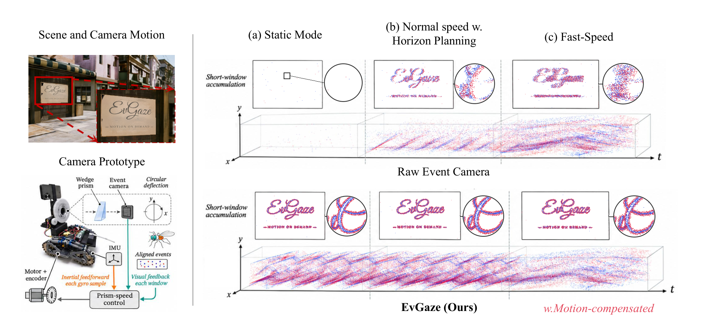
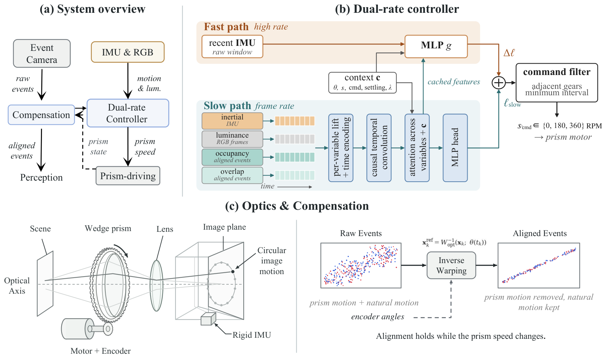

<h2 align="center">
  <a href="https://passwerob.github.io/EvGaze/">Motion on Demand: Adaptive Optical Excitation for Event Cameras</a>
</h2>
<h5 align="center">
If you like our project, please give us a star ⭐ on GitHub for the latest updates.
</h5>
<h5 align="center">

[](https://arxiv.org/abs/2611.30641)
<a href="https://passwerob.github.io/EvGaze/"></a> &nbsp;
[](https://github.com/Passwerob/EvGaze/blob/main/LICENSE)

</h5>

Implementation of **EvGaze**: Motion on Demand: Adaptive Optical Excitation for Event Cameras.



## 🗓️ TODO
We will release the code and dataset once the paper is accepted.

## 🔭 Overview


## ✏️ Citation
If you find our work useful, please consider citing:

```bibtex
@misc{li2026motion,
  title         = {Motion on Demand: Adaptive Optical Excitation for Event Cameras},
  author        = {Li, Yingtao and Feng, Chaoran and Jiang, Haoran and Tang, Zhenyu and Yu, Wangbo
                   and Xu, Zhankuo and Zhao, Jianbin and Yuan, Li and Tian, Yonghong},
  year          = {2026},
  eprint        = {2611.30641},
  archivePrefix = {arXiv},
  primaryClass  = {cs.CV},
  url           = {https://arxiv.org/abs/2611.30641}
}
```
